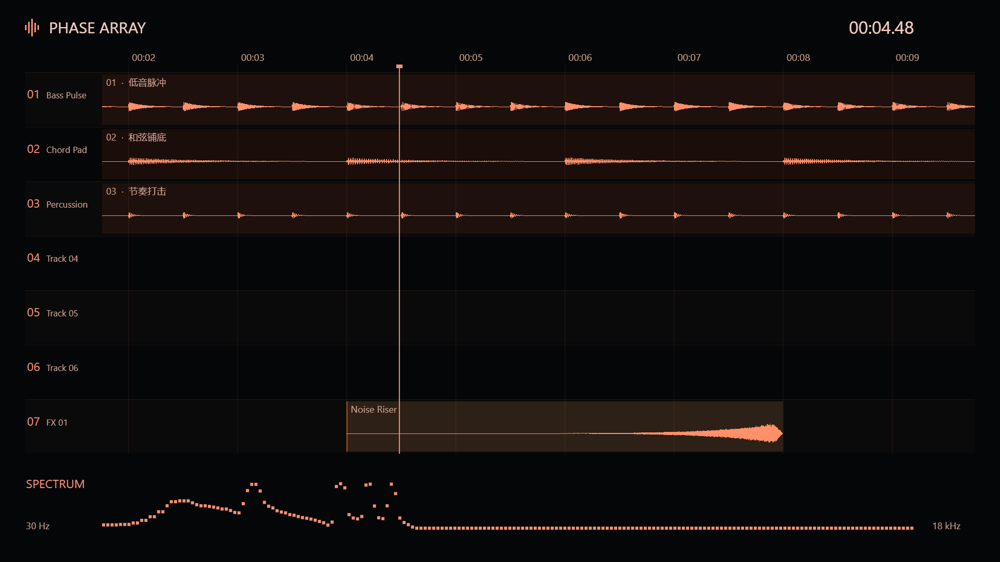
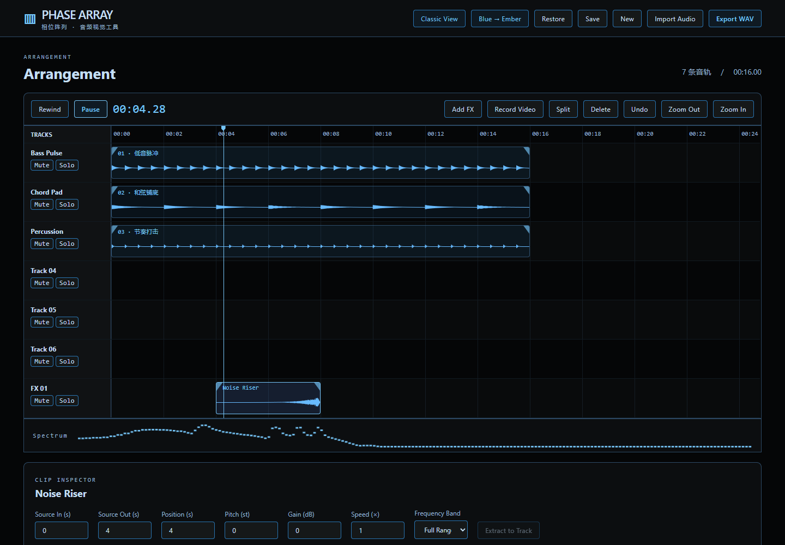
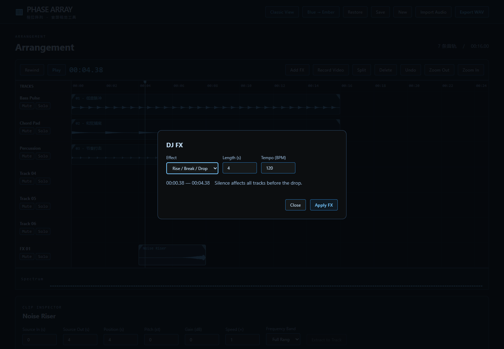
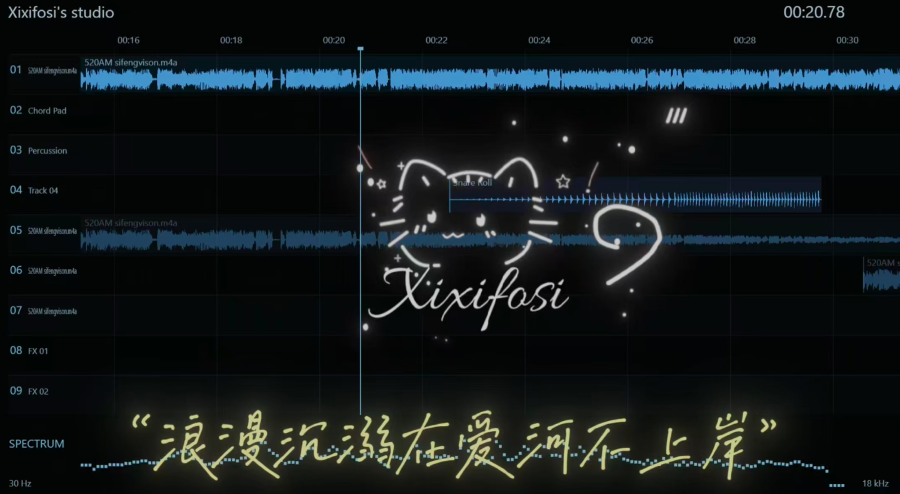

# PHASE ARRAY（相位阵列）音频视觉工具

一个能把多轨混音录成横屏视频的离线音频工作台。把声音拖到时间线上，剪好片段和转场，再用固定播放指针、滚动波形和实时频谱呈现整段混音。

**[下载单文件便携版（ZIP）](https://github.com/dizzynote-cell/phase-array/releases/latest/download/phase-array-portable.zip)** · [查看所有版本](https://github.com/dizzynote-cell/phase-array/releases)



## 第一次使用

1. 解压下载包，用桌面版 Edge 或 Chrome 打开 **PHASE ARRAY（相位阵列）音频视觉工具.html**。这个文件内含界面、音频库和示例声音，可离线运行。
2. 点播放试听示例。制作自己的作品时，点「新建」，再用「导入音频」选取本地文件。默认有六条普通轨和一条 FX 轨。
3. 拖动波形调整时间或跨轨移动。点击片段选定位置，按 **S** 分割；拖动片段上方两端的手柄设置淡入、淡出。在下方检查器调整增益、音调、速度和频段。
4. 点「横屏录像」，设定起止秒数后开始录制。录制按实际时长进行，结束后会下载视频。纯音频成品可直接导出立体声 WAV。

「保存工程」把当前工程保存在本机浏览器中。复制 HTML 可以分享工具，工程数据保存在原浏览器。

点击轨道左侧带铅笔图标的名称即可重命名普通轨或 FX 轨。自定义名称会随工程保存，并显示在录像中。

## 编排与转场



「DJ FX」提供白噪声上升、循环缩短、滤波扫频、回声退出、军鼓滚奏、停盘等 13 种预设。想在重拍切入下一段，可以先点时间线上的落点，再选「上升 → 留白 → 切入」。上升音会出现在 FX 轨，落点前最后半拍留白；整次操作可撤销。



## 录制与分享

- 经典界面和演播室界面可随时切换。演播室提供冰蓝、橘红两套音频响应配色。
- 录像输出为 1920 × 1080，默认目标帧率 60 FPS，也可选 30 FPS。实际流畅度取决于设备和浏览器编码性能。
- 在录像窗口调整时间窗口和波形高度，可以突出瞬态或展示整段编排。浏览器支持时优先导出 MP4，也支持回退到 WebM。

### 作者剪辑示例

下图是作者基于早期版本录像制作的成片截帧。中央图案和字幕来自后期剪辑。



## 源码与构建

直接打开仓库中的 `index.html` 即可运行分文件版本。修改同目录的 JavaScript 或 CSS 后，用 Python 3 重新生成单文件版：

```sh
python build_portable.py
```

音频合成与效果使用本地打包的 [Tone.js](https://github.com/Tonejs/Tone.js)。项目代码采用 [MIT 许可证](LICENSE)，允许使用、修改和再分发。随附依赖的许可及版权声明保存在 [vendor](vendor/) 中，并嵌入单文件版。
